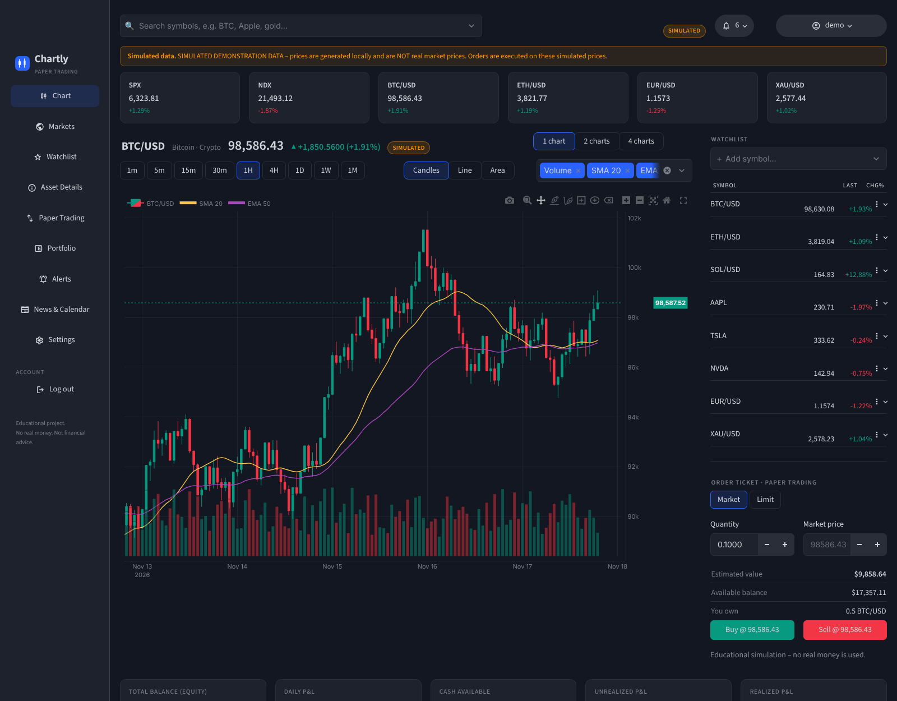

# Chartly – TradingView-inspired Paper-Trading Platform

A complete, client-server **trading terminal built 100 % in Python**: a **Streamlit** frontend that talks over
**REST/HTTP** to a separate **FastAPI** backend, with **SQLite + SQLAlchemy** persistence, **JWT + bcrypt** authentication,
interactive **Plotly** charts, technical indicators and a **paper-trading** engine (virtual $100,000 – no real money).



## Quick start

```bash
cd trading_platform
python -m venv .venv && source .venv/bin/activate      # Windows: .venv\Scripts\activate
pip install -r requirements.txt
python run.py
```

| Service | URL |
|---|---|
| Frontend (Streamlit) | http://localhost:8501 |
| Backend (FastAPI) | http://localhost:8000 |
| **Swagger UI** | http://localhost:8000/docs |

Create an account on the login screen (or `POST /api/auth/register`) – every new account gets $100,000 virtual cash and the
default watchlist (BTC, ETH, SOL, AAPL, TSLA, NVDA, EUR/USD, XAU/USD). The SQLite database `data/trading.db` is created
automatically on first start.

Optional: `cp .env.example .env` to change ports, secret key or data mode.
Run the servers separately if you prefer:

```bash
uvicorn backend.main:app --port 8000          # terminal 1
streamlit run frontend/app.py                 # terminal 2
```

## Real vs simulated data (important)
* `MARKET_DATA_MODE=auto` (default): **crypto** comes from **Binance's public market-data API** (real time, no key), all other
  assets from **Yahoo Finance** (can be delayed by minutes), news from public **RSS feeds**. TradingView itself has no public data API
  and scraping it is against its terms, so it is not used.
* **Live charts:** the chart, the price header and the watchlist refresh automatically every 2–3 s without reloading the page
  (zoom/pan are preserved); use the **● Live** switch above a chart to pause it. Binance candles update tick by tick.
* If the internet/feed is unreachable it falls back to a deterministic **simulator**. Simulated data is **always labelled**:
  every quote/candle response has `"source": "simulated"`, the UI shows an orange **SIMULATED** badge and a banner.
  Sample news and the economic calendar are labelled **SAMPLE**. Simulated prices are never presented as live.
* `MARKET_DATA_MODE=simulated` forces offline mode (used by the automated tests).
* Market caps shown are static approximate reference values.
* *Honest note:* the Binance/Yahoo/RSS code was tested with a faked HTTP layer only, because the development sandbox had no
  internet; the simulated path was also verified in a real browser. Binance can be blocked in some countries – the app then
  falls back to Yahoo, then to labelled simulated data. On a normal internet connection the live path is used automatically.

## Features
Dark/light TradingView-style UI with left toolbar, right watchlist and big chart · candlestick / line / area charts, volume,
zoom/pan, crosshair, drawing tools, full-screen button · 9 timeframes (1m…1M) · SMA, EMA, Bollinger Bands, RSI, MACD, volume
SMA/OBV (computed in the backend) · watchlist with search/add/remove/favourites (per user, saved in DB) · markets pages for
crypto, stocks, forex, commodities, indices (gainers, losers, most active, statistics) + heatmap · asset details · paper
trading (market & limit orders, positions, realized/unrealized P&L, order & transaction history, account reset) · price alerts &
notifications · news & economic calendar · settings (theme, default chart type/timeframe/symbol/indicators), profile,
password change · 1/2/4-chart layouts.

## Tests
```bash
pytest -q          # 73 tests: backend API, trading maths, indicators, DB persistence, restart test, frontend pages
```

## Project layout
```
trading_platform/
├── run.py                 starts backend + frontend
├── backend/               FastAPI: main.py, config.py, database.py, models/, schemas/, routers/, services/, security/
├── frontend/              Streamlit: app.py, api_client.py, state.py, pages/, components/
├── tests/                 pytest (TestClient + Streamlit AppTest)
├── docs/                  project_documentation.md, architecture.md, database_design.md, screenshots/
├── data/                  SQLite database (created at runtime)
├── requirements.txt  .env.example  .gitignore  pytest.ini  .streamlit/config.toml
```
Full school documentation: [`docs/project_documentation.md`](docs/project_documentation.md).

## Known limitations
* A browser refresh logs you out (the JWT lives in Streamlit session state).
* Schema is created with `create_all`; Alembic migrations are not included.
* Paper trading is long-only, without fees or leverage. Educational use only – not financial advice.
